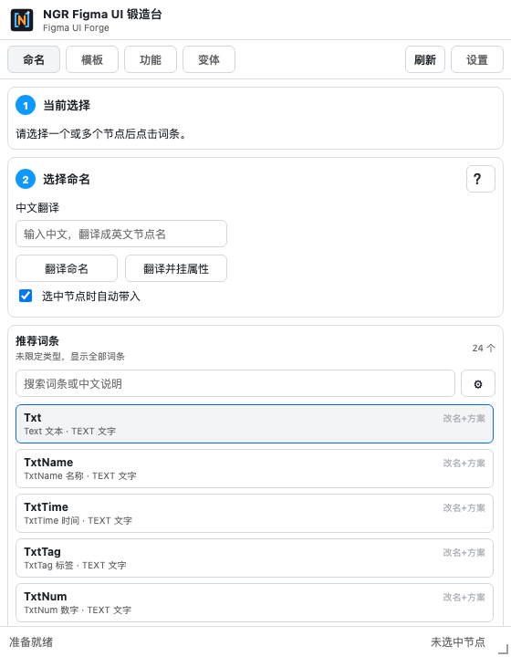

<div align="center">
  
  <h1>NGR Figma UI Forge</h1>
  <p>A Figma productivity plugin for game UI design and handoff.</p>
  <p><a href="./README.md">简体中文（默认）</a> · <strong>English</strong></p>
  <p><a href="https://github.com/907609732/NGR-Figma-UI-Forge/releases/tag/v0.1.61">Download v0.1.61</a> · <a href="https://figma.lttlt.top/">Website</a> · <a href="./docs/傻瓜式使用教程.md">User guide (Chinese)</a> · <a href="https://github.com/907609732/NGR-Figma-UI-Forge/issues">Report an issue</a></p>
</div>



## Overview

NGR Figma UI Forge brings node naming, translation, shared property presets, frame cleanup, program-control metadata, component variants, and template insertion into one workspace to reduce repetitive game UI production work.

The current release is **v0.1.61**, published on **November 3, 2026**. [Simplified Chinese](./README.md) is the default repository documentation language. Switching README languages does not change the plugin interface language.

## Download and install

1. Download the [v0.1.61 release ZIP](https://github.com/907609732/NGR-Figma-UI-Forge/releases/download/v0.1.61/NGR-Figma-UI-Forge-v0.1.61.zip).
2. Extract all files to a permanent folder.
3. Open Figma Desktop and choose **Plugins → Development → Import plugin from manifest**.
4. Select `manifest.json` in the extracted folder and launch **NGR Figma UI 锻造台**.
5. Reopen the plugin after updating an existing installation.

The package contains `manifest.json`, `code.js`, `ui.html`, and `README.md`. End users do not need Node.js. Earlier releases are available on [GitHub Releases](https://github.com/907609732/NGR-Figma-UI-Forge/releases).

Verify the ZIP against the published [SHA256SUMS.txt](https://github.com/907609732/NGR-Figma-UI-Forge/releases/download/v0.1.61/SHA256SUMS.txt). The SHA-256 for the v0.1.61 ZIP is:

```text
63a19427c311152ffe54e4ddd1e857ae968790ed4660cfadd27481bd3ce43ecd
```

## Features

| Feature | Description |
|---|---|
| Node naming and translation | Use node-type dictionaries, with optional Baidu Translate, OpenAI, and Kimi assistance |
| Shared property presets | Reuse typography, colors, opacity, position, constraints, corner radii, and other properties |
| Frame cleanup | Process hidden nodes, groups, masks, frame names, and program-control metadata according to configured rules |
| Program-control metadata | Write metadata to multiple selected nodes and recursively add dedicated Plugin Data to text and images |
| Button variants | Generate 3-, 4-, 6-, or 8-state combinations with Checked, Style, and Disabled options |
| Automatic state-layer visibility | Match descendant nodes named exactly `Normal`, `Hover`, `Pressed`, `Disabled`, or `Checked` |
| Style switching | Toggle matching style layers for normal/complete appearances or rank styles |
| Standard button structure | Optionally create `Content` + `HotZone` and attach program-control and button metadata |
| Template insertion | Use Figma Library Component Keys or built-in PC and IOS frame templates |
| Device-local configuration | Store dictionaries, property presets, and API settings; standard button structure starts disabled each session |

## Button variant behavior

Prepare the corresponding named layers in the source button first. Matching ignores case and surrounding whitespace but requires the full name. Names such as `Icon_Hover` do not match; missing layers are skipped.

When automatic state-layer switching is enabled:

| State | Normal | Hover | Pressed | Disabled |
|---|---|---|---|---|
| Normal | Visible | Hidden | Hidden | Hidden |
| Hover | Visible | Visible | Hidden | Hidden |
| Pressed | Visible | Visible | Visible | Hidden |
| Disabled | Visible | Hidden | Hidden | Visible |

`Checked` independently controls its matching layer: `Checked=Checked` shows it; `Checked=Unchecked` hides it. The state-layer automation above does not apply in Style-only mode or when appending Style to an existing Component Set.

Style visibility works independently of the state-layer toggle. A flat `Normal` layer remains the shared State base. When sibling `Normal` / `Complete` containers each hold a complete appearance with internal state layers, Style selects the outer container while State controls the internal layers. Appending Style to an existing variant set preserves its authored State / Checked visibility. Prepare the designs first; the plugin switches existing layers.

**Generate standard button structure (生成标准按钮结构) starts disabled every time the plugin opens.** After you enable it, newly generated state variants place visual layers inside a root `Content` container and add a full-size transparent `HotZone` on top. The hot zone uses horizontal and vertical Stretch constraints and receives `CMVarPropertyData` and `CMButtonPropertyData`. Style-only generation and Style appended to existing variant sets preserve the original structure.

## Guides and documentation

The detailed guides and videos below are currently in Chinese:

- [User guide](./docs/傻瓜式使用教程.md): installation and everyday operation.
- [Interaction reference](./docs/软件交互文档.md): screens, features, and interaction rules.
- [Architecture](./docs/软件底层架构.md): development, troubleshooting, and maintenance.
- [Online tutorial](https://figma.lttlt.top/tutorial).
- [Video 1: Download and installation](https://www.bilibili.com/video/BV1kmn865Eio/).
- [Video 2: Button variants](https://www.bilibili.com/video/BV1jxHK6KEs4/).

## Release history

| Version | Changes |
|---|---|
| v0.1.61 | Disable standard button structure on every launch; include preceding local-version updates |
| v0.1.60 | List both video tutorials in the software information panel |
| v0.1.59 | Add video links to the variant page and help dialog |
| v0.1.58 | Toggle matching Style layers; improve complete appearance containers and rank styles |
| v0.1.57 | Keep Normal visible, toggle Checked independently, and improve state matching and documentation |
| v0.1.56 | Add optional standard button structure and batch program-control metadata |

Versions v0.1.57 through v0.1.60 were delivered locally. Their updates are included in the public v0.1.61 release.

## Development and validation

The plugin uses the existing **TypeScript + esbuild** toolchain. GitHub Actions runs tests, type checking, and packaging with **Node.js 24**.

```powershell
cd system
npm.cmd ci
npm.cmd test
npm.cmd run typecheck
```

`npm test` builds the plugin first. After building, import the repository-root `manifest.json` into Figma Desktop. It points to `system/dist`.

| Path | Purpose |
|---|---|
| `system/src/` | Plugin main thread, shared types, and UI source |
| `system/dist/` | Build output for local development |
| `system/tests/` | Plugin automated tests |
| `.github/workflows/plugin-package.yml` | GitHub-hosted build, checks, and packaging |
| `docs/` | User guide, interaction rules, architecture, and release package notes |
| `website/` | Separate website project; see its [README (Chinese)](./website/README.md) |
| `assets/` | Brand SVGs and other source assets |

For the v0.1.61 release, all 28 tests and type checking passed on GitHub. The downloaded production bundle passed 16 variant tests and SHA-256 verification. A startup check confirmed that a previously saved enabled setting resets to disabled. That release did not include interactive acceptance testing inside Figma Desktop.

## API settings and privacy

Baidu Translate, OpenAI, and Kimi features require network access and the corresponding API configuration in settings. API settings are stored in Figma's plugin storage on the current device. Source and production packages exclude user API keys and local test configuration.

The production manifest limits network access to domains required by product features; development has a separate network configuration. Review the source and contents of external dictionaries or configuration before importing them.

Documentation updated: November 12, 2026 · [Repository](https://github.com/907609732/NGR-Figma-UI-Forge) · [Issues](https://github.com/907609732/NGR-Figma-UI-Forge/issues)
