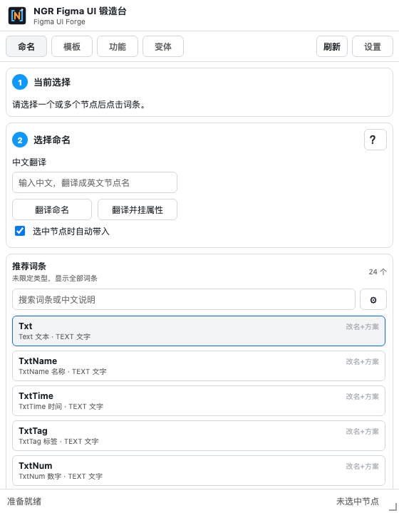

<div align="center">
  
  <h1>NGR Figma UI Forge · UI 锻造台</h1>
  <p>面向游戏 UI 设计与交付的 Figma 效率插件。</p>
  <p><strong>简体中文（默认）</strong> · <a href="./README.en.md">English</a></p>
  <p><a href="https://github.com/907609732/NGR-Figma-UI-Forge/releases/tag/v0.1.61">下载 v0.1.61</a> · <a href="https://figma.lttlt.top/">官方网站</a> · <a href="./docs/傻瓜式使用教程.md">使用教程</a> · <a href="https://github.com/907609732/NGR-Figma-UI-Forge/issues">反馈问题</a></p>
</div>



## 简介

NGR Figma UI Forge 把节点命名、翻译、共享属性、画板整理、程序控制属性、组件变体和模板插入集中到一个工作台，减少游戏 UI 生产中的重复操作。

当前正式版为 **v0.1.61**，发布于 **2026-11-03**。本页默认使用中文，英文介绍见 [English README](./README.en.md)。文档语言切换不改变插件界面语言。

## 下载与安装

1. 下载 [v0.1.61 正式版 ZIP](https://github.com/907609732/NGR-Figma-UI-Forge/releases/download/v0.1.61/NGR-Figma-UI-Forge-v0.1.61.zip)。
2. 解压到固定目录，保留包内全部文件。
3. 打开 Figma Desktop，进入“插件 → 开发 → 从 manifest 导入插件”。
4. 选择解压目录中的 `manifest.json`，启动“NGR Figma UI 锻造台”。
5. 更新已有插件后，重新打开插件。

正式包包含 `manifest.json`、`code.js`、`ui.html` 和 `README.md`，不需要安装 Node.js。历史版本见 [GitHub Releases](https://github.com/907609732/NGR-Figma-UI-Forge/releases)。

可使用 [SHA256SUMS.txt](https://github.com/907609732/NGR-Figma-UI-Forge/releases/download/v0.1.61/SHA256SUMS.txt) 核对 ZIP。v0.1.61 ZIP 的 SHA-256：

```text
63a19427c311152ffe54e4ddd1e857ae968790ed4660cfadd27481bd3ce43ecd
```

## 核心功能

| 功能 | 说明 |
|---|---|
| 节点命名与翻译 | 按节点类型使用词库，支持百度翻译、OpenAI 和 Kimi 辅助命名 |
| 共享属性方案 | 复用字体、字号、行高、颜色、透明度、位置、约束和圆角等属性 |
| 画板整理 | 按规则处理隐藏节点、Group、Mask、画板命名和程序控制属性 |
| 程序控制属性 | 批量为多选节点写入程序控制，递归为文本、图片写入专用 Plugin Data |
| 一键按钮变体 | 支持 3、4、6、8 状态，以及 Checked、Style 和 Disabled 组合 |
| 状态层自动切换 | 精确识别 `Normal`、`Hover`、`Pressed`、`Disabled`、`Checked` 后代节点 |
| Style 风格切换 | 按 Style 值切换同名风格节点，支持常态/完成和排名风格 |
| 标准按钮结构 | 可选生成 `Content` + `HotZone`，并给热区写入程序控制和按钮属性 |
| 模板插入 | 支持 Figma Library Component Key 和内置 PC、IOS 画板模板 |
| 本机配置 | 保存词库、属性方案和接口配置；标准按钮结构每次打开插件默认关闭 |

## 按钮变体规则

先在源按钮中准备对应名称的图层。匹配忽略大小写与首尾空格，只接受完整名称；`Icon_Hover` 等名称不会匹配，缺失图层直接跳过。

启用“按节点名切换状态层”后：

| State | Normal | Hover | Pressed | Disabled |
|---|---|---|---|---|
| Normal | 显示 | 隐藏 | 隐藏 | 隐藏 |
| Hover | 显示 | 显示 | 隐藏 | 隐藏 |
| Pressed | 显示 | 显示 | 显示 | 隐藏 |
| Disabled | 显示 | 隐藏 | 隐藏 | 显示 |

`Checked` 独立控制同名图层：`Checked=Checked` 显示，`Checked=Unchecked` 隐藏。仅 Style 模式和已有 Component Set 追加 Style 时，不应用上述状态层自动切换。

Style 同名风格切换独立于状态层开关。普通扁平 `Normal` 是共享的 State 基础层；同级 `Normal` / `Complete` 若是各自含状态层的完整外观容器，则外层按 Style 互斥、内部按 State 切换。已有变体集追加 Style 时保留原 State / Checked 显隐。需要事先准备设计，插件根据已有图层切换外观。

**“生成标准按钮结构”每次打开插件默认关闭。** 手动开启后，新建状态变体会将视觉内容收进根层 `Content`，在最上方放置全尺寸透明 `HotZone`。热区使用横纵 Stretch，并写入 `CMVarPropertyData` 和 `CMButtonPropertyData`。仅 Style 和已有变体集追加 Style 时不改变原结构。

## 教程与文档

以下详细文档与视频目前为中文：

- [傻瓜式使用教程](./docs/傻瓜式使用教程.md)：安装和日常操作。
- [软件交互文档](./docs/软件交互文档.md)：页面、功能与交互规则。
- [软件底层架构](./docs/软件底层架构.md)：开发、排错和维护。
- [在线教程](https://figma.lttlt.top/tutorial)。
- [视频第一集：下载安装](https://www.bilibili.com/video/BV1kmn865Eio/)。
- [视频第二集：一键变体](https://www.bilibili.com/video/BV1jxHK6KEs4/)。

## 版本更新

| 版本 | 更新 |
|---|---|
| v0.1.61 | 标准按钮结构每次启动默认关闭；汇总此前本地版本的功能更新 |
| v0.1.60 | 软件信息集中展示两集视频教程 |
| v0.1.59 | 变体页与帮助弹窗新增视频教程入口 |
| v0.1.58 | 自动切换 Style 同名风格节点，完善完整外观容器和排名模式 |
| v0.1.57 | Normal 常显、Checked 独立切换，完善状态层匹配与文档 |
| v0.1.56 | 可选标准按钮结构和批量程序控制属性 |

v0.1.57 至 v0.1.60 曾作为本地版本交付，其更新已包含在公开发布的 v0.1.61 中。

## 开发与验证

插件构建复用项目已有的 **TypeScript + esbuild**；GitHub Actions 使用 **Node.js 24** 执行测试、类型检查和打包。

```powershell
cd system
npm.cmd ci
npm.cmd test
npm.cmd run typecheck
```

`npm test` 会先构建插件。构建完成后，在 Figma Desktop 导入仓库根目录的 `manifest.json`，该文件指向 `system/dist`。

| 路径 | 用途 |
|---|---|
| `system/src/` | 插件主线程、共享类型与 UI 源码 |
| `system/dist/` | 本地开发使用的构建产物 |
| `system/tests/` | 插件自动化测试 |
| `.github/workflows/plugin-package.yml` | GitHub 云端构建、检查和打包 |
| `docs/` | 使用教程、交互规则、架构与发布包说明 |
| `website/` | 独立官网工程，开发说明见其 [README](./website/README.md) |
| `assets/` | 品牌 SVG 等源文件 |

v0.1.61 发布时，GitHub 云端 28 项测试与类型检查通过；下载的生产包通过 16 项变体测试与 SHA-256 核对，并确认旧配置保存为开启时，插件启动仍默认关闭标准按钮结构。本次发布未执行 Figma Desktop 内交互验收。

## 接口配置与隐私

百度翻译、OpenAI 和 Kimi 功能需要联网，并在设置中填写相应接口配置。API 配置保存在当前设备的 Figma 插件存储中。源码与生产包不包含用户 API 密钥或本机测试配置。

生产 manifest 限定产品功能所需的网络域名；开发环境另有网络权限配置。使用外部词库或导入配置前，请核对来源与内容。

文档更新：2026-11-12 · [仓库](https://github.com/907609732/NGR-Figma-UI-Forge) · [问题反馈](https://github.com/907609732/NGR-Figma-UI-Forge/issues)
