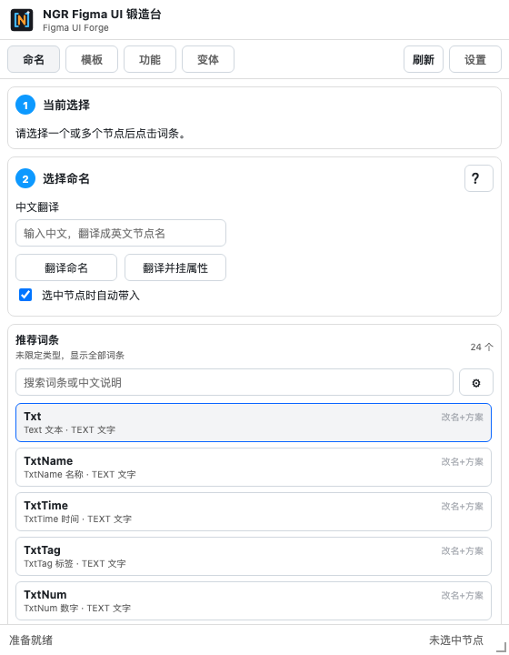

<div align="center">
  
  <h1>NGR Figma UI Forge</h1>
  <p><strong>NGR Figma UI 锻造台</strong> — 面向游戏 UI 生产流程的 Figma 效率插件。</p>
  <p>把节点命名、翻译、共享属性、画板整理、程序控制属性、组件变体和模板插入集中到一个工作台。</p>
  <p>
    <a href="https://github.com/907609732/NGR-Figma-UI-Forge/releases/tag/v0.1.61">下载正式版</a>
    ·
    <a href="https://figma.lttlt.top/">官方网站</a>
    ·
    <a href="https://figma.lttlt.top/tutorial">傻瓜式教程</a>
    ·
    <a href="./docs/软件底层架构.md">底层架构</a>
  </p>
</div>



## 产品定位

NGR Figma UI Forge 用于减少游戏 UI 设计和交付中的重复操作。设计师可以在 Figma 内完成规范命名、属性复用、画板整理和组件状态制作，并把结果交给程序或其他测试电脑继续验证。

当前正式版为 **v0.1.61**，支持 Figma Desktop 导入。

## 核心能力

- **节点命名与中文翻译**：根据节点类型推荐词库，支持百度翻译、OpenAI 和 Kimi 辅助命名。
- **共享属性方案**：复用字体、字号、行高、颜色、透明度、位置、约束和圆角等常用属性。
- **一键整理画板**：按规则处理隐藏节点、Group、Mask、画板命名和程序控制属性。
- **程序控制属性**：可批量给当前多选节点写入程序控制，也可递归为文本和图片写入专用 Figma Plugin Data。
- **一键变体**：生成跳转按钮、选择按钮、Checked、Style 和 Disabled 等组合状态。
- **状态层自动切换**：按后代节点名精确控制 `Normal`、`Hover`、`Pressed`、`Disabled`、`Checked`。
- **Style 风格切换**：按 `Style` 值自动切换同名风格节点，可生成两套外观或排名样式。
- **标准按钮结构**：可为新建状态变体自动整理 `Content` + `HotZone`，并给热区挂程序控制和按钮属性。
- **模板插入**：支持 Figma Library Component Key 和内置 PC、IOS 画板模板。
- **配置持久化**：词库、属性方案、API 配置和功能开关保存在当前设备。

## v0.1.61：标准按钮结构默认关闭

“生成标准按钮结构”每次打开插件默认关闭，不再恢复上次的开启状态，需要时手动勾选。包含 v0.1.57 至 v0.1.60 的状态层、Style 和视频教程更新。

## v0.1.60：两集视频教程入口

软件信息中集中列出 [第一集：下载安装](https://www.bilibili.com/video/BV1kmn865Eio/) 和 [第二集：一键变体](https://www.bilibili.com/video/BV1jxHK6KEs4/)，在浏览器观看。变体页继续保留第二集的快捷入口。

## v0.1.59：一键变体视频教程

变体页标题旁和功能帮助弹窗内新增“视频教程”入口，点击在浏览器观看 [第二集：一键变体（B站）](https://www.bilibili.com/video/BV1jxHK6KEs4/)。

## v0.1.58 本地修复版：Style 同名节点显隐

选择附加 Style 后，插件会自动打开与 `Style` 值同名的节点，关闭其他风格节点。例如 `Style=Complete` 打开 `Complete`，`Style=Normal` 关闭 `Complete`；排名模式只打开对应的 `1st`、`2nd` 或 `3rd`。先在源按钮中准备好不同外观，插件负责切换，不会自动设计另一套外观。

这项行为适用于新建变体、仅 Style 和已有 Component Set 追加 Style，不依赖“按节点名切换状态层”开关。匹配忽略大小写和首尾空格，只接受完整节点名，`Icon_Complete` 不匹配，缺失节点直接跳过。

普通扁平 `Normal` 节点仍是共享的 State 基础层。若同级 `Normal` / `Complete` 是两套完整外观容器，且 `Normal` 容器内含状态子层，外层按 Style 互斥，内部按 State 切换；仅 Style 模式下同级 `Normal` / `Complete` 也按 Style 互斥。已有变体集追加 Style 时保留原 State / Checked 的可见性。

本地验证已通过 28 项自动化测试，并在 Figma Desktop 中实测生成 8 个 State × Style 组合和 2 个仅 Style 变体。此版本仅本地交付，未创建 GitHub Release。

## v0.1.57 本地正式包（历史版本）

- 状态层精确匹配新增 `Normal` 与 `Checked`。
- Normal 在所有状态下保持打开；Hover、Pressed、Disabled 根据 State 切换，Pressed 继续同时打开 Hover。
- Checked 属性独立控制 `Checked` 节点，支持 Pressed + Checked / Unchecked 组合。
- 使用教程拆分为傻瓜式教程与软件底层架构文档。

> v0.1.57 历史本地包保留，不包含 v0.1.58 的 Style 同名节点显隐修复。

## v0.1.56 更新重点

- 一键变体新增可选的“生成标准按钮结构”，自动整理根层 `Content` + `HotZone`。
- `HotZone` 自动覆盖组件全尺寸、置于最上层，并写入程序控制与按钮属性。
- 已有标准节点会复用补齐，关闭开关时不改动原结构，失败时恢复源组件。
- 变体功能移动到插件第一页，并新增批量给当前多选节点添加程序控制。

## v0.1.55 更新重点

- 官方网站迁移到 [`figma.lttlt.top`](https://figma.lttlt.top/)，教程地址同步更新。
- 插件设置、正式版网络白名单、README 和官网统一使用新域名。
- 删除旧的 `uiforge.lttlt.top` 域名入口，保留 v0.1.54 的一键变体状态层能力。

## v0.1.54 功能重点

一键变体可启用“按节点名切换状态层”。开启后会递归检查组件后代，忽略大小写和首尾空格，只精确匹配 `Normal`、`Hover`、`Pressed`、`Disabled`、`Checked`。

| State | Normal 层 | Hover 层 | Pressed 层 | Disabled 层 |
|---|---:|---:|---:|---:|
| Normal | 打开 | 关闭 | 关闭 | 关闭 |
| Hover | 打开 | 打开 | 关闭 | 关闭 |
| Pressed | 打开 | 打开 | 存在时打开 | 关闭 |
| Disabled | 打开 | 关闭 | 关闭 | 存在时打开 |

- Pressed 状态会同时打开 Hover。
- Normal 在所有状态和 Checked 组合中始终打开。
- `Checked=Checked` 打开 `Checked`；`Checked=Unchecked` 关闭 `Checked`。
- `State=Pressed, Checked=Checked` 打开 `Hover + Pressed + Checked`。
- `State=Pressed, Checked=Unchecked` 打开 `Hover + Pressed`，关闭 `Checked`。
- 同名节点会全部处理，缺失节点直接跳过。
- `Icon_Normal`、`Icon_Hover`、`Icon_Checked` 等非精确名称不会被修改。
- 已有 Component Set 追加 Style 时不会启用该功能。

一键变体还可启用“生成标准按钮结构”。每个新建状态变体会把原内容包进根层 `Content`，并把全尺寸透明 `HotZone` 放在根层最上方。已有根层同名 Frame 会复用并补齐，缺失节点自动创建；`HotZone` 会写入 `CMVarPropertyData` 与 `CMButtonPropertyData`。该选项每次打开插件默认关闭，需要时手动开启，仅 Style 和已有 Component Set 追加 Style 时不生效。

## 下载与安装

### 推荐：GitHub Release

1. 下载 [NGR Figma UI Forge v0.1.61 正式版 ZIP](https://github.com/907609732/NGR-Figma-UI-Forge/releases/download/v0.1.61/NGR-Figma-UI-Forge-v0.1.61.zip)。
2. 将 ZIP 解压到任意固定目录。
3. 打开 Figma Desktop。
4. 进入“插件 → 开发 → 从 manifest 导入插件”。
5. 选择解压目录中的 `manifest.json`。
6. 在测试文件中启动“NGR Figma UI 锻造台”。

正式版只包含 `manifest.json`、`code.js`、`ui.html` 和测试说明，不包含源码、依赖、缓存、API 密钥或本机配置。

### 本地便携包

仓库中的 [`正式版软件/NGR-Figma-UI-Forge-v0.1.60`](./正式版软件/NGR-Figma-UI-Forge-v0.1.60) 是当前本地包，可直接复制或压缩到其他电脑测试。此前的 [`v0.1.59`](./正式版软件/NGR-Figma-UI-Forge-v0.1.59)、[`v0.1.58`](./正式版软件/NGR-Figma-UI-Forge-v0.1.58) 和 [`v0.1.57`](./正式版软件/NGR-Figma-UI-Forge-v0.1.57) 保留为历史版本。

## 使用说明

- 第一次使用：[傻瓜式使用教程](./docs/傻瓜式使用教程.md)
- 在线入门：[傻瓜式在线教程](https://figma.lttlt.top/tutorial)
- 开发、排错与维护：[软件底层架构](./docs/软件底层架构.md)
- 完整功能与页面规则：[软件交互文档](./docs/软件交互文档.md)
- 正式版本：[GitHub Releases](https://github.com/907609732/NGR-Figma-UI-Forge/releases)
- 问题反馈：[GitHub Issues](https://github.com/907609732/NGR-Figma-UI-Forge/issues)

百度翻译、OpenAI 和 Kimi 功能需要联网，并在插件设置中填写各自的接口配置。仓库和正式版软件不包含任何用户 API 密钥。

## 工作区结构

| 路径 | 用途 |
|---|---|
| `正式版软件/` | 可独立复制、压缩和测试的正式版插件 |
| `docs/` | 傻瓜式教程、软件交互规则和底层架构文档 |
| `system/src/` | Figma 插件主线程、共享类型和 UI 源码 |
| `system/dist/` | 开发工作区使用的已构建插件文件 |
| `system/scripts/` | 插件构建脚本 |
| `website/app/` | 官网首页、教程页、布局和样式 |
| `website/public/` | 官网图片、图标和分享图 |
| `website/tests/` | 官网渲染与链接测试 |
| `assets/` | 品牌 SVG 等可编辑源文件 |

根目录的 `manifest.json` 是开发工作区入口，指向 `system/dist`。`hidden_changes.conf` 用于隐藏 Plastic SCM 待处理列表中的工具目录噪音。

## 本地开发

网站工程要求 Node.js 22.13 或更高版本。依赖目录和构建缓存不提交到仓库。

### Figma 插件

```powershell
cd system
npm.cmd ci
npm.cmd run typecheck
npm.cmd run build
```

完成构建后，在 Figma Desktop 中导入仓库根目录的 `manifest.json`。

### 官网

```powershell
cd website
npm.cmd ci
npm.cmd run lint
npm.cmd test
```

## 安全与隐私

- API 配置只写入 Figma 当前设备的插件存储。
- 正式版和仓库不提交 API 密钥、测试账号或本机环境文件。
- 正式版 manifest 仅允许产品功能所需的网络域名，不包含开发环境的任意域名通配权限。
- 导入外部词库或配置前，建议先检查来源和内容。

## 版本信息

- 当前本地修复包：`v0.1.60`
- GitHub 下载入口版本：`v0.1.56`（沿用此前发布入口，本次未发布）
- 更新日期：`2026-10-24`
- 仓库：[`907609732/NGR-Figma-UI-Forge`](https://github.com/907609732/NGR-Figma-UI-Forge)
- v0.1.60 本地 ZIP SHA-256：`4AFC1DF1F27BA0046A3BB693CD828A38694873CBCD5CCB48819C22C13CF91066`
- v0.1.59 本地 ZIP SHA-256：`D060A1E0E91700D34872B21934885B8297B99BB5241BF49A31E96180BD684B0B`
- v0.1.58 本地 ZIP SHA-256：`69316C606AF9DB7D2B614CE51EB40005E9207663A678B38F1AC33481E62131B4`
- v0.1.57 本地 ZIP SHA-256：`BFDB7E5A53081839946A4B429454497389BCCCBB05781F1222CEF0BEC59BDC48`
